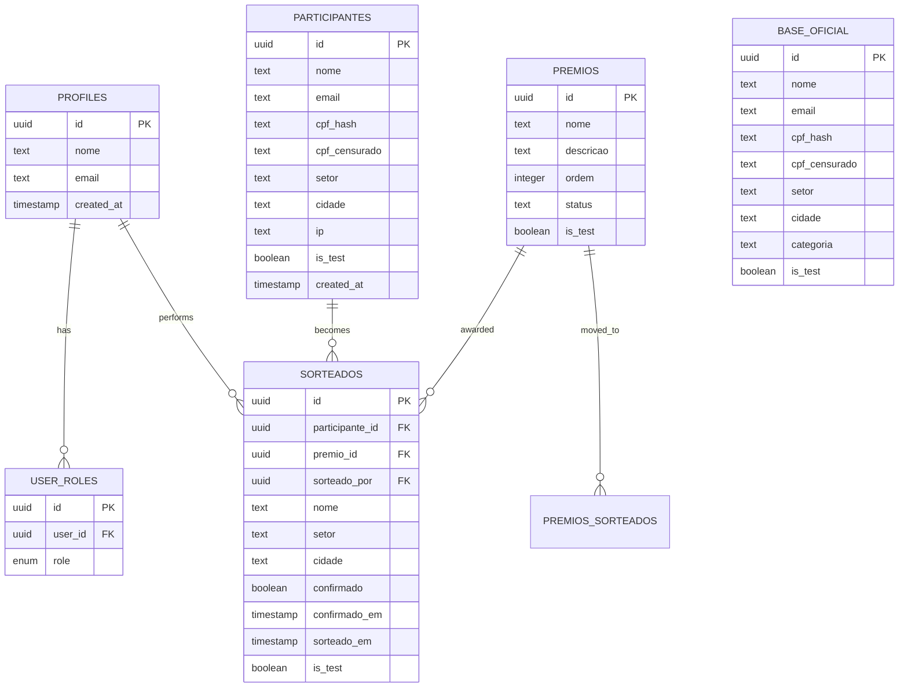
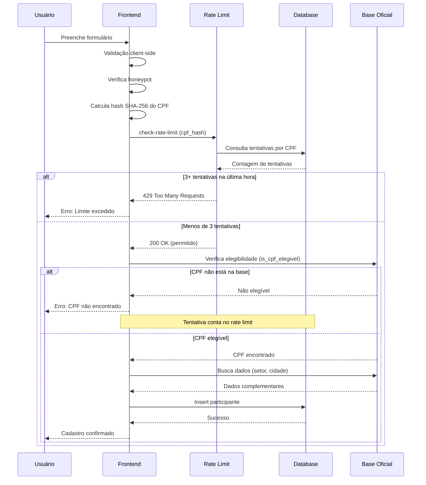
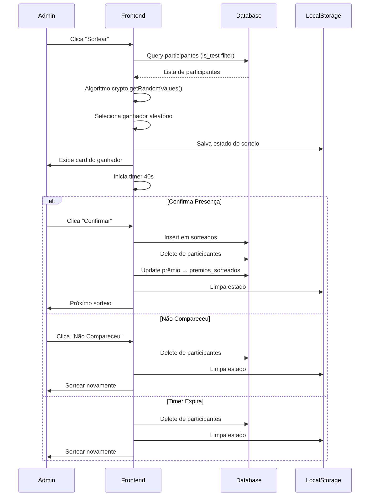
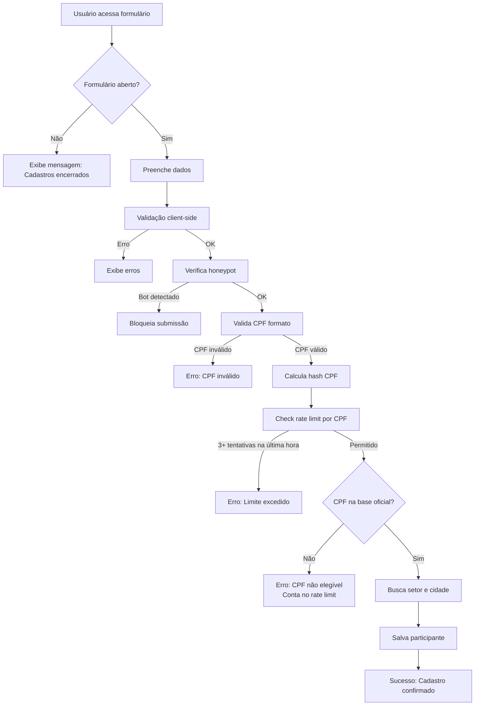
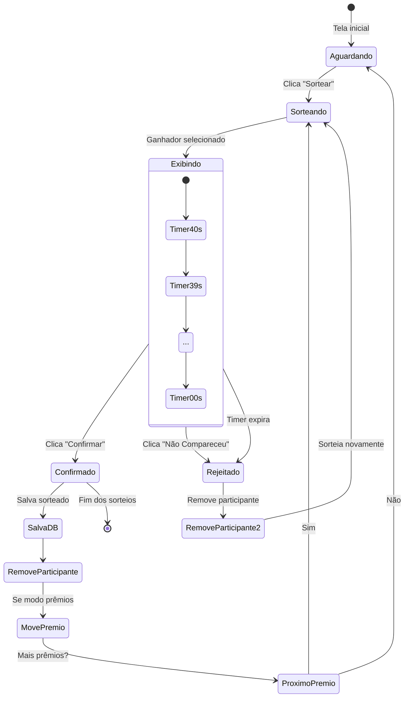
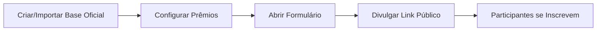
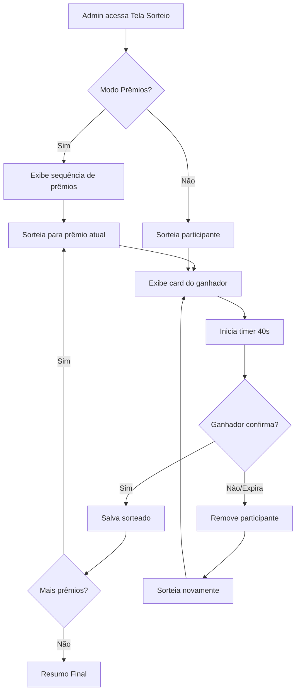
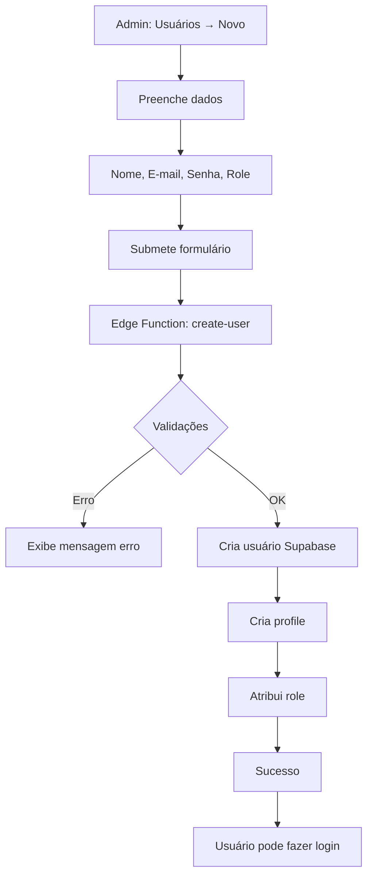
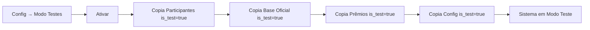
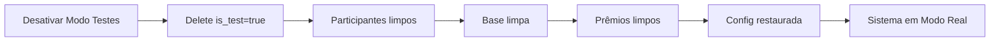

# Documentação do Sistema de Sorteios Sempre

## Versão 1.1 | Atualizado em: Novembro 2025

### Histórico de Alterações

**Versão 1.1 (Novembro 2025)**
- ✅ **Rate Limiting por CPF**: Sistema agora limita tentativas por CPF hash ao invés de IP
  - Permite múltiplos usuários do mesmo IP corporativo se cadastrarem
  - 3 tentativas por CPF por hora (inclui tentativas inválidas)
  - Previne força bruta para descoberta de CPFs elegíveis
- ✅ **Ordem de Validação Ajustada**: Rate limit verificado ANTES da elegibilidade
- ✅ **Privacidade Aprimorada**: Remoção da coleta ativa de IP para bloqueios
  - IP ainda registrado passivamente para auditoria
  - Sem necessidade de consentimento explícito LGPD para bloqueios

**Versão 1.0 (Novembro 2025)**
- Release inicial do sistema
- Todas as funcionalidades base implementadas

---

# 1. Introdução

## 1.1 Visão Geral

O **Sistema de Sorteios Sempre** é uma plataforma web completa desenvolvida para realizar sorteios automatizados e gerenciar participantes de forma segura e eficiente. O sistema foi projetado especificamente para a organização Sempre, permitindo a realização de sorteios com ou sem prêmios, gestão de participantes através de uma base oficial, e controle completo das configurações através de um painel administrativo.

## 1.2 Propósito

O sistema tem como principais objetivos:

- **Automatizar processos de sorteio**: Eliminar a necessidade de sorteios manuais através de um algoritmo justo e transparente
- **Gerenciar participantes**: Manter uma base oficial de participantes elegíveis com validação automática de CPF
- **Controlar inscrições**: Permitir abertura e fechamento controlado de formulários de inscrição com agendamento automático
- **Garantir segurança**: Implementar validações, rate limiting e proteção contra fraudes
- **Facilitar gestão**: Oferecer painel administrativo completo com controle de usuários, prêmios e configurações
- **Registrar histórico**: Manter registro completo de todas as ações administrativas e sorteios realizados

## 1.3 Público-Alvo

- **Administradores**: Usuários com acesso completo ao sistema, responsáveis pela configuração e gestão
- **Moderadores**: Usuários com permissões limitadas para realizar sorteios e visualizar dados
- **Participantes**: Público geral que pode se inscrever nos sorteios através do formulário público

## 1.4 Principais Funcionalidades

1. Cadastro público de participantes com validação automática
2. Base oficial de participantes em 4 categorias (Sempre, Autorizados, PJ, OnNet)
3. Sistema de sorteios com algoritmo criptograficamente seguro
4. Gestão de prêmios com ordenação customizável
5. Modo de testes para simulação sem afetar dados reais
6. Temas personalizáveis para a tela de sorteio
7. Agendamento automático de fechamento de formulário
8. Dashboard com estatísticas e gráficos
9. Histórico completo de ações administrativas
10. Sistema de autenticação com níveis de acesso

---

# 2. Arquitetura do Sistema

## 2.1 Visão Geral da Arquitetura

O sistema utiliza uma arquitetura moderna de aplicação web com separação clara entre frontend e backend:

```
┌─────────────────────────────────────────────────────────────┐
│                     FRONTEND (React)                         │
│  ┌────────────┐  ┌────────────┐  ┌─────────────────────┐   │
│  │   Public   │  │   Admin    │  │   Authentication    │   │
│  │   Pages    │  │   Panel    │  │     & Context       │   │
│  └────────────┘  └────────────┘  └─────────────────────┘   │
└─────────────────────────────────────────────────────────────┘
                            │
                            │ HTTPS / WebSocket
                            │
┌─────────────────────────────────────────────────────────────┐
│              LOVABLE CLOUD (Supabase Backend)               │
│  ┌─────────────┐  ┌──────────────┐  ┌──────────────────┐  │
│  │  Database   │  │ Edge         │  │   Storage        │  │
│  │ PostgreSQL  │  │ Functions    │  │   Buckets        │  │
│  └─────────────┘  └──────────────┘  └──────────────────┘  │
│  ┌─────────────┐  ┌──────────────┐  ┌──────────────────┐  │
│  │    Auth     │  │   Realtime   │  │   Row Level      │  │
│  │   System    │  │   Updates    │  │   Security       │  │
│  └─────────────┘  └──────────────┘  └──────────────────┘  │
└─────────────────────────────────────────────────────────────┘
                            │
                            │ Cron Jobs
                            │
┌─────────────────────────────────────────────────────────────┐
│              SERVIÇOS AUTOMATIZADOS                          │
│  ┌──────────────────────────────────────────────────────┐  │
│  │  Verificação Agendada de Fechamento (a cada minuto) │  │
│  └──────────────────────────────────────────────────────┘  │
└─────────────────────────────────────────────────────────────┘
```

## 2.2 Componentes Principais

### 2.2.1 Frontend

**Tecnologias:**
- React 18.3.1
- TypeScript
- Vite (Build Tool)
- TanStack Query (Gerenciamento de Estado)
- React Router DOM (Roteamento)
- Tailwind CSS (Estilização)
- shadcn/ui (Componentes UI)

**Estrutura de Diretórios:**
```
src/
├── components/          # Componentes reutilizáveis
│   ├── admin/          # Componentes específicos do painel admin
│   ├── sorteio/        # Componentes da tela de sorteio
│   └── ui/             # Componentes UI base (shadcn)
├── contexts/           # Contextos React (Auth, TestMode)
├── hooks/              # Hooks customizados
├── integrations/       # Integrações (Supabase)
├── lib/                # Utilitários e validações
├── pages/              # Páginas da aplicação
│   ├── admin/         # Páginas do painel administrativo
│   ├── Auth.tsx       # Página de login
│   ├── Index.tsx      # Página pública de cadastro
│   └── NotFound.tsx   # Página 404
└── main.tsx           # Entry point
```

### 2.2.2 Backend (Lovable Cloud / Supabase)

**Banco de Dados PostgreSQL:**

Tabelas principais:
1. `participantes` - Participantes inscritos nos sorteios
2. `base_oficial` - Base de participantes elegíveis (4 categorias)
3. `premios` - Prêmios disponíveis
4. `premios_sorteados` - Histórico de prêmios sorteados
5. `sorteados` - Participantes sorteados
6. `sorteios_realizados` - Registro de sorteios concluídos
7. `formulario_config` - Configurações do formulário público
8. `sistema_config` - Configurações gerais do sistema
9. `temas` - Temas visuais personalizáveis
10. `profiles` - Perfis de usuários
11. `user_roles` - Papéis e permissões de usuários
12. `historico_acoes` - Log de ações administrativas

**Edge Functions:**
1. `check-rate-limit` - Verifica limite de tentativas por CPF (3 tentativas/hora)
2. `check-form-schedule` - Verifica agendamento de fechamento
3. `create-user` - Criação de novos usuários admin/moderador

**Storage Buckets:**
- `temas` - Armazenamento de imagens de temas personalizados

## 2.3 Diagrama de Entidade-Relacionamento (Simplificado)



## 2.4 Fluxo de Dados

### Cadastro de Participante:



### Processo de Sorteio:



---

# 3. Funcionalidades

## 3.1 Cadastro Público de Participantes

### Descrição
Formulário público acessível em `/` que permite aos participantes se inscreverem nos sorteios.

### Campos do Formulário
1. **Nome Completo** (obrigatório, 3-200 caracteres, apenas letras)
2. **E-mail** (obrigatório, formato válido, max 255 caracteres)
3. **CPF** (obrigatório, 11 dígitos numéricos)

### Validações Implementadas

**Client-side:**
- Formato de nome (apenas letras e espaços)
- Formato de e-mail válido
- CPF com 11 dígitos numéricos
- Schema validation com Zod

**Server-side:**
- Validação matemática completa de CPF (dígitos verificadores)
- Validação de hash SHA-256 do CPF
- Rate limiting por CPF (3 tentativas por hora - verificado ANTES da elegibilidade)
- Verificação de elegibilidade na base oficial
- Proteção anti-bot (honeypot field)

### Fluxo de Cadastro



### Segurança
- Criptografia de CPF com SHA-256
- Armazenamento apenas do hash (não reversível)
- CPF censurado para exibição (***.***.***-XX)
- Rate limiting por CPF hash (3 tentativas/hora)
- Honeypot para detectar bots
- Validação dupla (client + server)
- Tentativas com CPF inválido contam no rate limit (proteção contra força bruta)

## 3.2 Base Oficial de Participantes

### Descrição
Sistema de gerenciamento da base oficial de participantes elegíveis, organizado em 4 categorias independentes.

### Categorias
1. **Sempre** - Participantes categoria padrão
2. **Autorizados** - Participantes autorizados especialmente
3. **PJ** - Pessoas Jurídicas
4. **OnNet** - Participantes OnNet

### Funcionalidades

**Importação de Dados:**
- Upload de arquivos XLSX
- Preview dos dados antes da importação
- Validação automática de CPF
- Importação por categoria (independente)
- Atualização automática da lista

**Visualização:**
- Abas separadas por categoria
- Paginação (20, 30, 50, 100, Todos)
- Busca e filtros
- Exibição de CPF censurado

**Gerenciamento:**
- Exclusão individual de participantes
- Limpeza completa por categoria
- Remoção automática de duplicatas (por CPF)
- Unificação automática entre categorias

### Estrutura de Dados
```typescript
interface BaseOficial {
  id: uuid
  nome: string
  email: string
  cpf_hash: string          // SHA-256
  cpf_censurado: string     // ***.***.**-12
  setor: string
  cidade: string
  categoria: 'sempre' | 'autorizados' | 'pj' | 'onnet'
  is_test: boolean
  created_at: timestamp
}
```

### Validações
- CPF único (não permite duplicatas)
- Validação matemática de CPF
- Campos obrigatórios: nome, email, cpf, setor, cidade
- Formato correto de e-mail

## 3.3 Sistema de Sorteios

### Descrição
Algoritmo de sorteio criptograficamente seguro que seleciona ganhadores de forma aleatória e justa.

### Algoritmo de Sorteio

**Método de Seleção:**
```typescript
// Utiliza crypto.getRandomValues() para geração segura de números aleatórios
const array = new Uint32Array(1);
crypto.getRandomValues(array);
const randomIndex = array[0] % participantes.length;
const ganhador = participantes[randomIndex];
```

**Características:**
- Aleatoriedade criptográfica (não pseudo-aleatória)
- Distribuição uniforme
- Não determinístico
- Transparente e auditável

### Modos de Sorteio

**1. Sorteio Simples (sem prêmios):**
- Sorteia participantes da lista
- Não associa prêmios
- Contador de confirmação opcional
- Remove participante após confirmação

**2. Sorteio com Prêmios:**
- Sorteia em sequência ordenada de prêmios
- Associa cada ganhador a um prêmio
- Move prêmio para "premios_sorteados" após confirmação
- Exibe "Prêmio Atual" e "Próximos Prêmios"

### Fluxo de Sorteio Detalhado



### Timer de Confirmação

**Configurações:**
- Tempo padrão: 40 segundos
- Configurável em "Configurações do Sistema"
- Pode ser desativado
- Exibição em formato MM:SS

**Comportamento:**
- Inicia automaticamente após sorteio
- Persistente entre navegações (LocalStorage)
- Ao expirar: participante automaticamente rejeitado
- Visual: countdown regressivo no card do ganhador

### Persistência de Estado

O sistema salva o estado do sorteio em `localStorage` para permitir navegação sem perder o progresso:

```typescript
interface SorteioState {
  ganhadorId: string
  ganhadorDados: {
    nome: string
    setor: string
    cidade: string
  }
  premioId?: string
  sorteadoEm: number        // timestamp
  deadline: number          // timestamp + 40s
}
```

**Recuperação de Estado:**
- Ao retornar à página de sorteio
- Verifica se existe sorteio em andamento
- Se dentro de 40s: restaura card e continua timer
- Se após 40s: processa como "não compareceu" automaticamente

## 3.4 Gestão de Prêmios

### Funcionalidades

**Cadastro de Prêmios:**
- Nome do prêmio (obrigatório)
- Descrição (opcional)
- Ordem de sorteio
- Status: Disponível / Sorteado

**Ordenação:**
- Drag & drop para reordenar
- Botões ↑ ↓ para mover
- Persistência automática no banco
- Reflexo imediato na tela de sorteio

**Visualização:**
- Aba "Prêmios" (disponíveis)
- Aba "Sorteados" (histórico)
- Paginação e busca

**Gestão:**
- Edição de prêmios
- Exclusão (apenas admins)
- Movimentação automática para "Sorteados"

### Estrutura de Dados

```typescript
interface Premio {
  id: uuid
  nome: string
  descricao?: string
  ordem: number
  status: 'Disponível' | 'Sorteado'
  is_test: boolean
  created_at: timestamp
  updated_at: timestamp
}

interface PremioSorteado {
  id: uuid
  premio_id: uuid
  nome: string
  descricao?: string
  sorteado_em: timestamp
  is_test: boolean
}
```

## 3.5 Modo de Testes

### Descrição
Ambiente isolado para simulação de todas as operações sem afetar dados reais.

### Funcionamento

**Ativação:**
1. Admin acessa "Configurações" → "Modo de Testes"
2. Clica "Ativar Modo de Testes"
3. Sistema cria cópia dos dados sensíveis com flag `is_test: true`

**Dados Copiados:**
- Participantes
- Base oficial
- Prêmios
- Configurações do sistema

**Durante o Modo de Testes:**
- Todas as queries filtram por `is_test: true`
- Sorteios usam apenas dados de teste
- Histórico registrado como teste
- Contadores isolados

**Desativação:**
1. Clica "Desativar Modo de Testes"
2. Sistema deleta todos os registros com `is_test: true`
3. Retorna aos dados originais

### Indicador Visual
- Badge "MODO DE TESTES" visível em todas as telas admin
- Cor de destaque (amarelo/laranja)

## 3.6 Temas Personalizáveis

### Descrição
Sistema de temas que permite personalizar visualmente a tela de sorteio.

### Configurações de Tema

**Elementos Personalizáveis:**
1. **Imagem de Fundo** (obrigatório)
2. **Logo** (opcional)
3. **Textura de Overlay** (opcional)
4. **Estilo do Título:**
   - Cor sólida
   - Degradê (com direção configurável)

**Degradê:**
- Cor início
- Cor fim
- Direção: to right, to left, to top, to bottom, diagonal

### Gestão de Temas

**Upload de Imagens:**
- Suporte a JPG, PNG, WEBP
- Armazenamento no bucket `temas`
- URLs públicas

**Ativação:**
- Apenas 1 tema ativo por vez
- Ativação automática desativa outros
- Aplicação imediata na tela de sorteio

**Lista de Temas:**
- Visualização com preview
- Edição completa
- Exclusão (apenas admins)
- Indicador de tema ativo

### Aplicação
- Tela de sorteio carrega tema ativo
- Fallback para tema padrão se nenhum ativo
- Atualização em tempo real

## 3.7 Agendamento de Fechamento

### Descrição
Sistema automático que fecha o formulário de inscrição em data/hora agendada.

### Configuração

**Interface:**
1. Admin acessa "Gerenciar Formulário"
2. Marca "Ativar fechamento automático"
3. Seleciona data e hora (timezone: America/Sao_Paulo)
4. Salva configuração

**Armazenamento:**
- Data convertida para UTC no banco
- Exibição sempre em horário de Brasília
- Campo: `data_fechamento_agendado`

### Mecanismo de Verificação

**Edge Function: check-form-schedule**
```typescript
// Executada a cada minuto via Cron Job
1. Verifica se há agendamento ativo
2. Compara horário atual com agendamento
3. Se passou: fecha formulário
4. Atualiza: aberto = false
5. Registra: data_fechamento
6. Desativa: fechamento_automatico_ativo = false
```

**Cron Job:**
- Frequência: 1 minuto
- Autenticação: CRON_SECRET
- Endpoint: `/check-form-schedule`

**Verificação Manual:**
- Botão "Verificar agora" no painel
- Executa edge function imediatamente
- Útil para testes

### Segurança
- Edge function protegida por CRON_SECRET
- Aceita chamadas com Authorization header
- Logs de execução

## 3.8 Dashboard e Estatísticas

### Descrição
Painel com visão geral do sistema e estatísticas de sorteios realizados.

### Indicadores

**Contadores em Tempo Real:**
- Total de participantes inscritos
- Total de prêmios disponíveis
- Prêmios já sorteados
- Sorteios realizados

**Gráfico de Evolução:**
- Gráfico de linha: Participantes por Sorteio
- Eixo X: Número do sorteio
- Eixo Y: Quantidade de participantes
- Visualiza crescimento ao longo do tempo

**Estatísticas:**
- Média de participantes por sorteio
- Maior sorteio registrado (valor + data)
- Crescimento semanal/mensal
- Taxa de conversão

### Registro de Sorteios

**Tabela: sorteios_realizados**
```typescript
interface SorteioRealizado {
  id: uuid
  data_inicio: timestamp    // Início do cadastro
  data_fim: timestamp       // Momento da limpeza
  total_participantes: number
  is_test: boolean
}
```

**Criação de Registro:**
- Automática ao limpar lista de participantes
- Captura total de participantes no momento
- Marca início (primeiro cadastro) e fim (limpeza)

### Filtros
- Por período
- Modo teste / real
- Exportação de dados

## 3.9 Histórico de Ações

### Descrição
Log completo de todas as ações administrativas realizadas no sistema.

### Ações Registradas

1. **Importação de Dados:**
   - Base oficial (por categoria)
   - Lista de participantes
   - Lista de prêmios

2. **Limpeza de Dados:**
   - Limpeza de participantes
   - Limpeza de base oficial (por categoria)
   - Limpeza de prêmios

3. **Exclusões:**
   - Exclusão individual de participantes
   - Exclusão de usuários
   - Exclusão de prêmios

4. **Configurações:**
   - Ativação/Desativação do modo de testes
   - Abertura/Fechamento do formulário
   - Alterações em configurações gerais

5. **Usuários:**
   - Criação de usuários
   - Alteração de roles

### Estrutura do Registro

```typescript
interface HistoricoAcao {
  id: uuid
  usuario_id: uuid
  usuario_nome: string
  acao: string              // Tipo da ação
  detalhes: string          // Informações adicionais
  is_test: boolean
  created_at: timestamp
}
```

### Visualização
- Lista cronológica (mais recente primeiro)
- Filtros por tipo de ação
- Filtro por usuário
- Filtro por período
- Paginação
- Exibição de contexto (teste/real)

## 3.10 Autenticação e Controle de Acesso

### Sistema de Autenticação

**Método:**
- E-mail e senha
- Supabase Auth
- Auto-confirm habilitado (não requer confirmação de e-mail)

**Sessão:**
- Persistente (localStorage)
- Auto-refresh de token
- Logout manual

### Níveis de Acesso

**1. Admin (Administrador):**
- Acesso completo a todas as funcionalidades
- Criar/Editar/Excluir usuários
- Gerenciar configurações do sistema
- Gerenciar base oficial
- Realizar sorteios
- Visualizar todos os dados
- Ativar/Desativar modo de testes

**2. Moderator (Moderador):**
- Realizar sorteios
- Visualizar participantes e base oficial
- Visualizar prêmios
- Visualizar histórico
- **Não pode:**
  - Criar/Excluir usuários
  - Modificar configurações
  - Gerenciar base oficial
  - Ativar modo de testes

### Controle via RLS (Row Level Security)

**Políticas Implementadas:**

Exemplos:
```sql
-- Apenas admins podem inserir na base oficial
CREATE POLICY "Apenas admins podem inserir na base oficial"
ON base_oficial FOR INSERT
WITH CHECK (has_role(auth.uid(), 'admin'));

-- Admins e moderadores podem ver participantes
CREATE POLICY "Admins e moderadores podem ver participantes"
ON participantes FOR SELECT
USING (has_role(auth.uid(), 'admin') OR has_role(auth.uid(), 'moderator'));

-- Apenas admins podem atualizar configurações
CREATE POLICY "Apenas admins podem atualizar config"
ON sistema_config FOR UPDATE
USING (has_role(auth.uid(), 'admin'))
WITH CHECK (has_role(auth.uid(), 'admin'));
```

### Criação de Usuários

**Edge Function: create-user**

Processo:
1. Admin acessa "Usuários" → "Novo Usuário"
2. Preenche: nome, e-mail, senha, role
3. Edge function valida requisição
4. Cria usuário via Supabase Admin API
5. Insere profile e role
6. Retorna sucesso/erro

**Validações:**
- E-mail único
- Senha mínimo 6 caracteres
- Role válido (admin/moderator)
- Apenas admins podem criar usuários

---

# 4. Processos de Negócio

## 4.1 Processo Completo de Sorteio

### Etapa 1: Preparação



**Ações do Admin:**
1. Importar base oficial por categoria (XLSX)
2. Cadastrar prêmios (se modo prêmios ativo)
3. Ordenar prêmios na sequência desejada
4. Configurar sistema (timer, modo prêmios)
5. Abrir formulário de inscrição
6. Opcional: Agendar fechamento automático

**Ações dos Participantes:**
1. Acessar link público
2. Preencher nome, e-mail e CPF
3. Submeter formulário
4. Aguardar confirmação

### Etapa 2: Coleta de Inscrições

**Validações Automáticas:**
- CPF deve estar na base oficial
- CPF matematicamente válido
- Rate limit: máx 3 tentativas/hora por CPF
- Honeypot para detectar bots
- E-mail formato válido

**Auto-preenchimento:**
- Sistema busca setor e cidade da base oficial
- Associa ao participante automaticamente

### Etapa 3: Encerramento de Inscrições

**Manual:**
- Admin acessa "Gerenciar Formulário"
- Clica "Fechar Formulário"

**Automático:**
- Data/hora agendada é atingida
- Cron job executa edge function
- Formulário fechado automaticamente

### Etapa 4: Realização do Sorteio



**Ações durante sorteio:**
1. Clica "Sortear"
2. Sistema seleciona ganhador aleatório
3. Exibe card com dados do ganhador
4. Timer de 40s inicia
5. Admin aguarda ou confirma presença
6. Se confirma: ganhador salvo, próximo prêmio
7. Se rejeita/expira: participante removido, sorteia novamente
8. Repetir até todos os prêmios sorteados

**Persistência:**
- Estado salvo em localStorage
- Permite navegação sem perder progresso
- Restaura timer ao voltar

### Etapa 5: Finalização

**Ações Automáticas:**
- Prêmios movidos para "Sorteados"
- Participantes confirmados salvos em "Sorteados"
- Participantes rejeitados removidos da lista
- Registro do sorteio criado

**Resumo Final:**
- Exibição de todos os ganhadores
- Lista de prêmios distribuídos
- Opção de exportar resultados

### Etapa 6: Pós-Sorteio

**Limpeza de Dados:**
1. Admin acessa "Participantes"
2. Clica "Limpar Lista"
3. Todos os participantes removidos
4. Registro de sorteio criado automaticamente
5. Sistema pronto para próximo sorteio

**Manutenção de Histórico:**
- Sorteados permanecem registrados
- Prêmios sorteados mantidos
- Histórico de ações preservado
- Estatísticas atualizadas

## 4.2 Processo de Gestão de Usuários

### Criação de Novo Usuário



### Alteração de Nível de Acesso

**Processo:**
1. Admin acessa "Usuários"
2. Localiza usuário na lista
3. Clica ícone "UserCog"
4. Seleciona novo role (admin/moderator)
5. Confirma alteração
6. Sistema atualiza `user_roles`
7. Mudança aplicada imediatamente

**Sem necessidade de:**
- Deletar usuário
- Recriar conta
- Novo login

## 4.3 Processo de Modo de Testes

### Ativação



### Uso em Modo Teste

**Todas as operações isoladas:**
- Queries filtram `is_test = true`
- Sorteios usam dados teste
- Importações marcadas como teste
- Exclusões afetam apenas dados teste
- Histórico separado

**Indicador visual:**
- Badge "MODO DE TESTES" em todas as telas

### Desativação



**Resultado:**
- Todos os dados de teste deletados
- Sistema volta ao estado original
- Dados reais intocados

---

# 5. Componentes Técnicos

## 5.1 Stack Tecnológico

### Frontend

| Tecnologia | Versão | Propósito |
|------------|--------|-----------|
| React | 18.3.1 | Framework UI |
| TypeScript | 5.x | Type safety |
| Vite | 5.x | Build tool |
| Tailwind CSS | 3.x | Estilização |
| shadcn/ui | Latest | Componentes UI |
| TanStack Query | 5.83.0 | State management |
| React Router DOM | 6.30.1 | Roteamento |
| React Hook Form | 7.61.1 | Formulários |
| Zod | 3.25.76 | Validação schemas |
| date-fns | 3.6.0 | Manipulação de datas |
| Recharts | 2.15.4 | Gráficos |
| XLSX | 0.18.5 | Importação Excel |
| Lucide React | 0.462.0 | Ícones |
| Sonner | 1.7.4 | Notifications |

### Backend (Lovable Cloud / Supabase)

| Componente | Tecnologia | Propósito |
|------------|------------|-----------|
| Database | PostgreSQL 15 | Banco de dados relacional |
| Auth | Supabase Auth | Autenticação de usuários |
| Storage | Supabase Storage | Armazenamento de arquivos |
| Edge Functions | Deno | Serverless functions |
| Realtime | WebSockets | Atualizações em tempo real |
| RLS | PostgreSQL RLS | Segurança nível de linha |

### Infraestrutura

- **Hospedagem Frontend**: Lovable Platform
- **Hospedagem Backend**: Supabase Cloud
- **CDN**: Supabase CDN para assets
- **Cron Jobs**: Supabase Cron

## 5.2 Arquitetura de Componentes React

### Estrutura de Contextos

```typescript
// AuthContext - Gerencia autenticação e roles
interface AuthContextType {
  user: User | null
  session: Session | null
  isAdmin: boolean
  isModerator: boolean
  loading: boolean
}

// TestModeContext - Gerencia modo de testes
interface TestModeContextType {
  isTestMode: boolean
  isLoading: boolean
  activateTestMode: () => Promise<void>
  deactivateTestMode: () => Promise<void>
}
```

### Principais Hooks Customizados

```typescript
// useTestModeQuery - Facilita queries com filtro de teste
const { isTestMode, testFilter } = useTestModeQuery();

// use-mobile - Detecta dispositivos móveis
const isMobile = useMobile();

// use-toast - Sistema de notificações
const { toast } = useToast();
```

### Componentes Principais

**Admin Layout:**
```
AdminLayout
├── AdminSidebar (menu lateral)
├── Header (48px altura)
└── Outlet (conteúdo das páginas)
```

**Páginas Admin:**
- Dashboard - Visão geral e estatísticas
- Participantes - Lista de inscritos
- BaseOficial - Gestão base oficial (4 abas)
- Premios - Gestão de prêmios (2 abas)
- Sorteio - Tela de sorteio
- Temas - Gestão de temas
- Usuarios - Gestão de usuários
- Configuracoes - Configurações gerais (3 abas)
- Historico - Log de ações
- Sobre - Informações do sistema

## 5.3 Estrutura do Banco de Dados

### Tabelas Principais

#### participantes
```sql
CREATE TABLE participantes (
  id UUID PRIMARY KEY DEFAULT gen_random_uuid(),
  nome TEXT NOT NULL,
  email TEXT NOT NULL,
  cpf_hash TEXT NOT NULL,
  cpf_censurado TEXT NOT NULL,
  setor TEXT NOT NULL,
  cidade TEXT NOT NULL,
  ip TEXT,  -- Coletado passivamente para auditoria, não usado para bloqueios
  is_test BOOLEAN DEFAULT false,
  created_at TIMESTAMPTZ DEFAULT now()
);

CREATE UNIQUE INDEX idx_participantes_cpf ON participantes(cpf_hash, is_test);
CREATE INDEX idx_participantes_test ON participantes(is_test);
CREATE INDEX idx_participantes_ip ON participantes(ip);  -- Mantido para consultas de auditoria
```

**Observações:**
- Coluna `ip` é preenchida por trigger mas NÃO é usada para rate limiting
- Rate limiting é feito por `cpf_hash` (3 tentativas/hora)
- IP mantido apenas para fins de auditoria e análise posterior

#### base_oficial
```sql
CREATE TABLE base_oficial (
  id UUID PRIMARY KEY DEFAULT gen_random_uuid(),
  nome TEXT NOT NULL,
  email TEXT NOT NULL,
  cpf_hash TEXT NOT NULL UNIQUE,
  cpf_censurado TEXT NOT NULL,
  setor TEXT NOT NULL,
  cidade TEXT NOT NULL,
  categoria TEXT NOT NULL DEFAULT 'sempre',
  is_test BOOLEAN DEFAULT false,
  created_at TIMESTAMPTZ DEFAULT now(),
  
  CONSTRAINT valid_categoria CHECK (categoria IN ('sempre', 'autorizados', 'pj', 'onnet'))
);

CREATE INDEX idx_base_oficial_categoria ON base_oficial(categoria);
CREATE INDEX idx_base_oficial_test ON base_oficial(is_test);
```

#### premios
```sql
CREATE TABLE premios (
  id UUID PRIMARY KEY DEFAULT gen_random_uuid(),
  nome TEXT NOT NULL,
  descricao TEXT,
  ordem INTEGER NOT NULL,
  status TEXT DEFAULT 'Disponível',
  is_test BOOLEAN DEFAULT false,
  created_at TIMESTAMPTZ DEFAULT now(),
  updated_at TIMESTAMPTZ DEFAULT now()
);

CREATE INDEX idx_premios_ordem ON premios(ordem);
CREATE INDEX idx_premios_test ON premios(is_test);
```

#### sorteados
```sql
CREATE TABLE sorteados (
  id UUID PRIMARY KEY DEFAULT gen_random_uuid(),
  participante_id UUID REFERENCES participantes(id),
  premio_id UUID REFERENCES premios(id),
  sorteado_por UUID REFERENCES profiles(id),
  nome TEXT NOT NULL,
  setor TEXT NOT NULL,
  cidade TEXT NOT NULL,
  confirmado BOOLEAN,
  confirmado_em TIMESTAMPTZ,
  sorteado_em TIMESTAMPTZ DEFAULT now(),
  is_test BOOLEAN DEFAULT false
);

CREATE INDEX idx_sorteados_test ON sorteados(is_test);
```

### Funções do Banco

#### validate_cpf_format
```sql
CREATE FUNCTION validate_cpf_format(cpf_input TEXT)
RETURNS BOOLEAN AS $$
-- Valida formato e dígitos verificadores do CPF
-- Retorna true se CPF válido, false caso contrário
$$;
```

#### validate_cpf_hash
```sql
CREATE FUNCTION validate_cpf_hash(hash TEXT)
RETURNS BOOLEAN AS $$
-- Valida formato SHA-256 (64 caracteres hexadecimais)
$$;
```

#### is_cpf_elegivel
```sql
CREATE FUNCTION is_cpf_elegivel(cpf_hash_input TEXT)
RETURNS BOOLEAN AS $$
-- Verifica se CPF existe na base oficial
$$;
```

#### get_dados_base_oficial
```sql
CREATE FUNCTION get_dados_base_oficial(cpf_hash_input TEXT)
RETURNS TABLE(setor TEXT, cidade TEXT) AS $$
-- Retorna setor e cidade do CPF na base oficial
$$;
```

#### has_role
```sql
CREATE FUNCTION has_role(_user_id UUID, _role app_role)
RETURNS BOOLEAN AS $$
-- Verifica se usuário tem role específico
$$;
```

### Triggers

#### validate_cpf_trigger
```sql
CREATE TRIGGER validate_cpf_trigger
BEFORE INSERT ON participantes
FOR EACH ROW
EXECUTE FUNCTION validate_cpf_on_insert();

-- Também em base_oficial
```

#### set_tema_ativo
```sql
CREATE TRIGGER set_tema_ativo
BEFORE UPDATE ON temas
FOR EACH ROW
EXECUTE FUNCTION set_tema_ativo();
-- Desativa outros temas ao ativar um
```

#### update_updated_at
```sql
CREATE TRIGGER update_updated_at
BEFORE UPDATE ON premios
FOR EACH ROW
EXECUTE FUNCTION update_updated_at_column();
```

## 5.4 Edge Functions

### check-rate-limit

**Arquivo:** `supabase/functions/check-rate-limit/index.ts`

**Propósito:** Verificar limite de tentativas de cadastro por CPF (3 tentativas/hora)

**Funcionamento:**
```typescript
1. Recebe cpf_hash no body da requisição
2. Valida presença do cpf_hash
3. Consulta participantes da última hora com esse cpf_hash
4. Conta tentativas de cadastro
5. Se >= 3: retorna 429 Too Many Requests
6. Se < 3: retorna 200 OK com contagem atual
```

**Request:**
```json
{
  "cpf_hash": "a1b2c3...64-char-sha256-hash"
}
```

**Response (Permitido):**
```json
{
  "allowed": true,
  "count": 1,
  "limit": 3
}
```

**Response (Bloqueado):**
```json
{
  "allowed": false,
  "count": 3,
  "limit": 3,
  "message": "Você já tentou se cadastrar recentemente com este CPF..."
}
```

**Segurança:**
- Tentativas com CPF inválido/não elegível CONTAM no limite
- Previne força bruta para descobrir CPFs elegíveis
- Não expõe informações sobre validade do CPF
- Rate limit aplicado ANTES da verificação de elegibilidade

**Configuração:**
```toml
[functions.check-rate-limit]
verify_jwt = false  # Público
```

### check-form-schedule

**Arquivo:** `supabase/functions/check-form-schedule/index.ts`

**Propósito:** Fechar formulário automaticamente no horário agendado

**Funcionamento:**
```typescript
1. Autenticação via CRON_SECRET ou Authorization
2. Busca formulario_config
3. Verifica se fechamento_automatico_ativo
4. Compara now() com data_fechamento_agendado
5. Se passou: atualiza aberto = false
6. Registra data_fechamento
7. Desativa fechamento_automatico_ativo
```

**Cron Job:**
```
* * * * *  # A cada minuto
```

**Configuração:**
```toml
[functions.check-form-schedule]
verify_jwt = false
```

### create-user

**Arquivo:** `supabase/functions/create-user/index.ts`

**Propósito:** Criar novos usuários admin/moderador

**Funcionamento:**
```typescript
1. Valida Authorization header
2. Verifica se requisitante é admin
3. Valida dados do novo usuário
4. Usa Supabase Admin API para criar usuário
5. Insere em profiles
6. Insere role em user_roles
7. Retorna sucesso ou rollback em caso de erro
```

**Segurança:**
- Requer autenticação
- Apenas admins podem executar
- Service Role Key para operações admin

## 5.5 Segurança e Validações

### Row Level Security (RLS)

**Princípios:**
- Todas as tabelas têm RLS habilitado
- Políticas baseadas em roles (has_role function)
- Separação admin/moderator
- Público pode apenas inserir em participantes (quando formulário aberto)

**Exemplos de Políticas:**

```sql
-- Participantes: público pode inserir apenas se formulário aberto
CREATE POLICY "public_insert_when_open"
ON participantes FOR INSERT
WITH CHECK (is_form_open());

-- Base Oficial: apenas admin pode modificar
CREATE POLICY "admin_only_modify"
ON base_oficial FOR ALL
USING (has_role(auth.uid(), 'admin'));

-- Sorteados: admin e moderator podem ver
CREATE POLICY "admin_mod_select"
ON sorteados FOR SELECT
USING (
  has_role(auth.uid(), 'admin') OR 
  has_role(auth.uid(), 'moderator')
);
```

### Validações de Segurança

**CPF:**
- Client-side: formato e comprimento
- Server-side: validação matemática completa
- Trigger: valida antes de insert
- Hash SHA-256: não reversível
- Unicidade: previne duplicatas

**Rate Limiting:**
- CPF hash tracking (não IP)
- 3 tentativas por CPF por hora
- Verificado ANTES da elegibilidade
- Edge function independente
- Honeypot para bots

**Autenticação:**
- JWT tokens
- Refresh automático
- RLS baseado em auth.uid()
- Roles verificados em tempo real

**LGPD:**
- CPF armazenado apenas como hash SHA-256 (não reversível)
- Exibição censurada (***.***.***-XX)
- Transparência no uso dos dados
- IP coletado passivamente apenas para auditoria (não usado para bloqueios)

---

# 6. Guia de Instalação e Configuração

## 6.1 Pré-requisitos

### Software Necessário

1. **Node.js** (versão 18 ou superior)
   - Download: https://nodejs.org/
   - Verificar: `node --version`

2. **npm** (vem com Node.js)
   - Verificar: `npm --version`

3. **Git** (opcional, mas recomendado)
   - Download: https://git-scm.com/
   - Verificar: `git --version`

### Conta Lovable

- Criar conta em: https://lovable.dev/
- Plano recomendado: Pro ou superior

## 6.2 Instalação Local (Desenvolvimento)

### Passo 1: Clonar o Repositório

```bash
# Clonar via Git
git clone <URL_DO_REPOSITORIO>
cd sorteia-tudo-sempre

# OU baixar ZIP e extrair
```

### Passo 2: Instalar Dependências

```bash
npm install
```

### Passo 3: Configurar Variáveis de Ambiente

**Arquivo `.env`:**

```env
VITE_SUPABASE_URL=sua_url_supabase
VITE_SUPABASE_PUBLISHABLE_KEY=sua_chave_publica
VITE_SUPABASE_PROJECT_ID=seu_project_id
```

⚠️ **NUNCA** commitar o arquivo `.env` no repositório!

### Passo 4: Executar em Desenvolvimento

```bash
npm run dev
```

Acesse: `http://localhost:5173`

## 6.3 Configuração do Backend (Lovable Cloud)

### Ativação do Lovable Cloud

1. Acesse seu projeto no Lovable
2. Vá em Settings → Cloud
3. Clique "Enable Lovable Cloud"
4. Aguarde provisionamento (alguns minutos)

### Configuração Inicial do Banco

As tabelas são criadas automaticamente pelas migrations em:
```
supabase/migrations/
```

Não é necessário executar SQL manualmente.

### Configuração de Secrets

**Secrets necessários:**
- `CRON_SECRET` - Para edge function de agendamento

**Como adicionar:**
1. Lovable → Cloud → Secrets
2. Add Secret
3. Nome: `CRON_SECRET`
4. Valor: string aleatória segura
5. Save

### Configuração do Cron Job

1. Lovable → Cloud → Edge Functions
2. Selecionar `check-form-schedule`
3. Configure Cron: `* * * * *` (a cada minuto)
4. Header: `x-cron-secret: [seu_cron_secret]`

## 6.4 Primeiro Acesso

### Criar Primeiro Admin

**Opção 1: Via Supabase Dashboard (recomendado)**

1. Acesse Lovable → Cloud → Database
2. Vá em "Authentication" → "Users"
3. Create User manualmente
4. Após criar, execute SQL:

```sql
INSERT INTO user_roles (user_id, role)
VALUES ('user_id_aqui', 'admin');
```

**Opção 2: Via SQL direto**

```sql
-- 1. Criar usuário no Auth (substituir valores)
-- Isso deve ser feito via Supabase Auth UI

-- 2. Após criado, adicionar role
INSERT INTO user_roles (user_id, role)
VALUES ('uuid_do_usuario', 'admin');
```

### Login Inicial

1. Acesse `/auth`
2. Entre com e-mail e senha criados
3. Será redirecionado para `/admin`

## 6.5 Configurações Iniciais do Sistema

### 1. Configurar Sistema

**Admin → Configurações → Configurações Gerais**

- **Tempo de Confirmação**: 40 segundos (padrão)
- **Ativar Contador**: sim/não
- **Sorteio com Prêmios**: sim/não

### 2. Importar Base Oficial

**Admin → Base Oficial → Aba desejada**

1. Preparar arquivo XLSX com colunas:
   - nome
   - email
   - cpf (11 dígitos numéricos)
   - setor
   - cidade

2. Click "Importar Planilha"
3. Selecionar arquivo
4. Preview dos dados
5. Confirmar importação

### 3. Configurar Prêmios (opcional)

**Admin → Prêmios**

1. "Novo Prêmio"
2. Nome e descrição
3. Ordem será automática
4. Salvar
5. Reordenar arrastando se necessário

### 4. Configurar Tema (opcional)

**Admin → Temas**

1. "Novo Tema"
2. Upload imagem de fundo
3. Upload logo (opcional)
4. Configurar cores do título
5. Ativar tema

### 5. Abrir Formulário

**Admin → Configurações → Gerenciar Formulário**

1. Marcar "Formulário Aberto"
2. Opcional: Agendar fechamento
3. Salvar

## 6.6 Deploy para Produção

### Publicar no Lovable

1. Click "Publish" no Lovable
2. Aguardar build
3. URL pública será gerada

### Conectar Domínio Próprio (opcional)

1. Lovable → Settings → Domains
2. Add Domain
3. Configurar DNS (CNAME)
4. Aguardar verificação

---

# 7. Guia de Uso

## 7.1 Para Participantes

### Como se Inscrever no Sorteio

1. **Acessar o link público** fornecido pela organização
   - Geralmente no formato: `https://[seu-dominio].lovable.app`

2. **Verificar se inscrições estão abertas**
   - Mensagem verde: "Cadastros abertos"
   - Mensagem vermelha: "Cadastros encerrados"

3. **Preencher o formulário:**
   - **Nome Completo**: Seu nome como está nos documentos
   - **E-mail**: E-mail válido para contato
   - **CPF**: Apenas números, sem pontos ou traços

4. **Enviar**
   - Clicar em "Participar do Sorteio"
   - Aguardar mensagem de confirmação

### Mensagens Possíveis

✅ **"Cadastro realizado com sucesso!"**
- Você está inscrito no sorteio

❌ **"CPF não encontrado na base elegível"**
- Seu CPF não está autorizado para este sorteio
- Contate o organizador

❌ **"Limite de tentativas excedido"**
- Você já tentou se cadastrar 3 vezes com este CPF na última hora
- Aguarde alguns minutos e tente novamente

❌ **"CPF inválido"**
- CPF informado é matematicamente inválido
- Verifique os números digitados

### Privacidade

- Seu CPF é criptografado (SHA-256)
- Apenas hash é armazenado (não reversível)
- CPF é usado para controle de tentativas de cadastro (3 por hora)
- Dados não são compartilhados com terceiros
- Sistema protege contra tentativas de força bruta

## 7.2 Para Administradores

### Login no Painel Administrativo

1. Acessar `/auth` ou clicar "Login" na página inicial
2. Inserir e-mail e senha
3. Clicar "Entrar"
4. Redirecionamento automático para `/admin`

### Dashboard

**O que você vê:**
- Total de participantes inscritos
- Total de prêmios disponíveis
- Prêmios sorteados
- Gráfico de evolução de participantes
- Estatísticas de sorteios

**Ações disponíveis:**
- Nenhuma ação direta
- Use menu lateral para outras funções

### Gerenciar Participantes

**Visualizar lista:**
1. Menu → Participantes
2. Lista com todos os inscritos
3. Paginação (20, 30, 50, 100, Todos)

**Buscar participante:**
- Campo de busca no topo
- Busca por nome, e-mail, setor ou cidade

**Exportar lista:**
- Botão "Exportar Excel"
- Download imediato em XLSX

**Excluir participante:**
- Botão vermelho na linha
- Confirmação necessária
- Apenas admins

**Limpar toda a lista:**
- Botão "Limpar Lista"
- **ATENÇÃO**: Remove TODOS os participantes
- Cria registro de sorteio automaticamente
- Confirmação necessária

### Gerenciar Base Oficial

**Acessar:**
- Menu → Base Oficial

**Abas disponíveis:**
- Sempre
- Autorizados
- PJ
- OnNet

**Importar planilha:**

1. Selecionar aba desejada
2. Clicar "Importar Planilha"
3. Selecionar arquivo XLSX

**Formato do arquivo:**
```
| nome | email | cpf | setor | cidade |
|------|-------|-----|-------|--------|
| João | j@... | 123...| TI | SP |
```

4. Preview dos dados
5. Conferir informações
6. Confirmar importação

**Excluir participante da base:**
- Botão vermelho na linha
- Confirmação necessária
- Apenas admins

**Limpar categoria:**
- Botão "Limpar [Categoria]"
- Remove todos da categoria selecionada
- Confirmação necessária

### Gerenciar Prêmios

**Aba "Prêmios" (disponíveis):**

**Adicionar prêmio:**
1. Clicar "Novo Prêmio"
2. Preencher nome (obrigatório)
3. Descrição (opcional)
4. Salvar
5. Ordem automática (final da lista)

**Editar prêmio:**
1. Clicar ícone de edição
2. Modificar dados
3. Salvar

**Reordenar prêmios:**

Opção 1 - Arrastar:
1. Clicar e segurar nas 6 bolinhas (⋮⋮)
2. Arrastar para nova posição
3. Soltar
4. Salvamento automático

Opção 2 - Botões:
1. Usar setas ↑ ↓
2. Clique move uma posição
3. Salvamento automático

**Excluir prêmio:**
- Botão vermelho
- Confirmação necessária
- Apenas admins

**Aba "Sorteados" (histórico):**
- Visualização apenas
- Lista de prêmios já distribuídos
- Não permite edição

### Realizar Sorteio

**Preparação:**

1. Menu → Sorteio
2. Verificar configurações:
   - Modo prêmios ativo? Sequência aparece
   - Timer ativo? Contador aparece
3. Verificar participantes disponíveis

**Processo de sorteio:**

**Modo SIMPLES (sem prêmios):**

1. Clicar "Sortear"
2. Sistema exibe ganhador
3. Timer inicia (se ativo)
4. Opções:
   - **Confirmar Presença**: Salva e remove da lista
   - **Não Compareceu**: Remove e sorteia novamente
5. Repetir até finalizar

**Modo COM PRÊMIOS:**

1. Ver "Prêmio Atual" e "Próximos Prêmios"
2. Clicar "Sortear"
3. Ganhador para prêmio atual exibido
4. Timer inicia (se ativo)
5. Opções:
   - **Confirmar**: Associa prêmio, salva, próximo prêmio
   - **Não Compareceu**: Remove participante, sorteia novamente
6. Repetir para cada prêmio
7. Final: "Ver Resumo Final"

**Navegação durante sorteio:**
- Pode trocar de página
- Estado salvo automaticamente
- Ao voltar, continua de onde parou
- Timer ajustado ao tempo decorrido

**Restauração de estado:**
- Se saiu durante sorteio ativo
- Ao voltar: card e timer restaurados
- Se passou mais de 40s: processado como "não compareceu"

**Resumo final:**
- Lista todos os ganhadores
- Prêmios distribuídos
- Opção de exportar

### Gerenciar Temas

**Criar novo tema:**

1. Menu → Temas
2. "Novo Tema"
3. Preencher:
   - Nome do tema
   - Descrição
   - Upload imagem de fundo (obrigatório)
   - Upload logo (opcional)
   - Estilo do título:
     - **Cor**: Selecionar cor única
     - **Degradê**: Escolher 2 cores + direção
   - Upload textura (opcional)
4. Salvar

**Ativar tema:**
1. Lista de temas
2. Botão "Ativar" no tema desejado
3. Desativa automaticamente outros temas
4. Aplicação imediata na tela de sorteio

**Editar tema:**
1. Ícone de edição
2. Modificar campos desejados
3. Salvar

**Excluir tema:**
- Botão vermelho
- Confirmação necessária
- Apenas admins

### Gerenciar Usuários

**Listar usuários:**
- Menu → Usuários
- Exibe nome, e-mail e role

**Criar novo usuário:**

1. Clicar "Novo Usuário"
2. Preencher:
   - Nome completo
   - E-mail (único)
   - Senha (mínimo 6 caracteres)
   - Nível de Acesso:
     - **Admin**: Acesso total
     - **Moderator**: Acesso limitado
3. Salvar
4. Usuário pode fazer login imediatamente

**Alterar nível de acesso:**

1. Localizar usuário na lista
2. Clicar ícone "UserCog" (engrenagem com usuário)
3. Selecionar novo role:
   - Admin
   - Moderator
4. Confirmar
5. Mudança aplicada instantaneamente

**Excluir usuário:**
- Botão vermelho
- Confirmação necessária
- Apenas admins
- **ATENÇÃO**: Ação irreversível

### Configurações do Sistema

**Menu → Configurações**

**Aba "Configurações Gerais":**

1. **Modo de Sorteio:**
   - ☐ Sorteio com Prêmios
   - Ativa/desativa associação de prêmios

2. **Contador de Tempo:**
   - ☐ Ativar contador
   - Tempo em segundos (padrão: 40)

3. **Modo de Testes:**
   - Ver seção específica abaixo

**Aba "Gerenciar Formulário":**

1. **Status do Formulário:**
   - ☐ Formulário Aberto
   - Liga/desliga inscrições públicas

2. **Fechamento Automático:**
   - ☐ Ativar fechamento automático
   - Selecionar data e hora
   - Timezone: Brasília (America/Sao_Paulo)
   - Botão "Verificar Agora" para teste

**Aba "Gerenciar Dados":**

1. **Limpar Participantes:**
   - Remove todos os inscritos
   - Cria registro de sorteio
   - Confirmação necessária

2. **Exportações:**
   - Exportar participantes
   - Exportar base oficial
   - Exportar histórico

### Modo de Testes

**Ativar:**

1. Configurações → Modo de Testes
2. Clicar "Ativar Modo de Testes"
3. Aguardar cópia dos dados
4. Badge "MODO DE TESTES" aparece

**Durante modo ativo:**
- Todas as operações isoladas
- Dados reais intocados
- Importações marcadas como teste
- Sorteios usam participantes teste
- Histórico separado

**Desativar:**
1. Configurações → Modo de Testes
2. Clicar "Desativar Modo de Testes"
3. Confirmação necessária
4. Todos os dados teste deletados
5. Sistema volta ao normal

**Uso recomendado:**
- Treinar equipe
- Testar fluxo de sorteio
- Simular importações
- Experimentar sem risco

### Histórico de Ações

**Acessar:**
- Menu → Histórico

**O que é registrado:**
- Importações (base, participantes, prêmios)
- Limpezas de dados
- Exclusões
- Criação/alteração de usuários
- Ativação/desativação modo teste
- Abertura/fechamento formulário

**Informações exibidas:**
- Data e hora
- Usuário responsável
- Tipo de ação
- Detalhes
- Contexto (teste/real)

**Filtros:**
- Por tipo de ação
- Por usuário
- Por período
- Modo teste/real

## 7.3 Para Moderadores

Moderadores têm acesso limitado:

✅ **Podem:**
- Ver dashboard
- Ver lista de participantes
- Ver base oficial
- **Realizar sorteios**
- Ver prêmios
- Ver histórico
- Ver temas

❌ **Não podem:**
- Criar/excluir usuários
- Modificar configurações
- Importar/limpar base oficial
- Criar/excluir prêmios
- Criar/excluir temas
- Ativar modo de testes
- Limpar dados

---

# 8. Manutenção e Atualizações

## 8.1 Manutenção Rotineira

### Backup Regular

**Dados do Banco:**

1. **Via Lovable Cloud:**
   - Cloud → Database → Tables
   - Selecionar tabela
   - Export

2. **Frequência recomendada:**
   - Base oficial: Semanal
   - Antes de grandes importações
   - Antes de sorteios importantes

**Arquivos de imagens (temas):**
- Manter cópias locais das imagens
- Documentar configurações de temas

### Limpeza de Dados

**Após cada sorteio:**
1. Limpar lista de participantes
2. Verificar registro de sorteio criado
3. Conferir prêmios movidos para "Sorteados"

**Periódica:**
- Revisar base oficial (trimestral)
- Limpar logs antigos de histórico (anual)
- Arquivar sorteados antigos (anual)

### Monitoramento

**Métricas a acompanhar:**
- Número de participantes por sorteio
- Taxa de confirmação de presença
- Erros de validação de CPF
- Tentativas bloqueadas por rate limit

**Logs importantes:**
- Edge function logs (Cloud → Functions)
- Database logs (Cloud → Database → Logs)
- Erros de autenticação

## 8.2 Atualizações de Código

### Fluxo de Atualização via Lovable

1. **Backup completo antes de atualizar**

2. **Testar em modo de testes primeiro:**
   - Ativar modo teste
   - Aplicar mudanças
   - Validar funcionamento
   - Desativar modo teste

3. **Deploy:**
   - Lovable faz deploy automático
   - Frontend atualizado instantaneamente
   - Edge functions deployadas automaticamente

4. **Verificação pós-deploy:**
   - Testar login
   - Testar cadastro público
   - Testar sorteio
   - Verificar edge functions

### Migrations de Banco

**Quando necessário:**
- Adicionar novas tabelas
- Modificar estrutura existente
- Adicionar índices
- Alterar policies RLS

**Processo:**
1. Migration criada automaticamente pelo Lovable
2. Salva em `supabase/migrations/`
3. Execução automática no deploy
4. **Sempre fazer backup antes**

**Rollback:**
- Não há rollback automático
- Manter migrations antigas
- Preparar migration reversa se necessário

## 8.3 Atualizações de Dependências

### Verificar Dependências Desatualizadas

```bash
npm outdated
```

### Atualizar Dependências

**Minor/Patch updates (seguro):**
```bash
npm update
```

**Major updates (testar bem):**
```bash
npm install package@latest
```

**Dependências críticas:**
- React
- Supabase client
- TanStack Query
- Zod (validações)

**Testar sempre:**
1. Localmente primeiro
2. Em modo de testes
3. Deploy em horário de baixo uso

## 8.4 Resolução de Issues Comuns

### Issue: Formulário não abre

**Verificar:**
1. `formulario_config.aberto = true`
2. RLS policy permite SELECT público
3. Edge function funcionando

**Solução:**
```sql
UPDATE formulario_config
SET aberto = true
WHERE id = (SELECT id FROM formulario_config LIMIT 1);
```

### Issue: Rate limit muito restritivo

**Ajustar em:**
`supabase/functions/check-rate-limit/index.ts`

```typescript
const RATE_LIMIT = 3;  // Alterar valor
const TIME_WINDOW = 60; // minutos
```

Deploy automático após salvar.

### Issue: Sorteio não persiste estado

**Verificar:**
1. LocalStorage habilitado no navegador
2. Chave correta: `sorteioState`
3. Formato JSON válido

**Limpar estado manualmente:**
```javascript
localStorage.removeItem('sorteioState');
```

### Issue: CPF válido rejeitado

**Verificar:**
1. CPF existe na base oficial
2. Hash SHA-256 correto
3. Função `is_cpf_elegivel` funcionando

**Testar CPF:**
```sql
SELECT * FROM base_oficial 
WHERE cpf_hash = 'hash_aqui';
```

### Issue: Prêmios fora de ordem

**Reordenar:**
```sql
UPDATE premios
SET ordem = 1
WHERE id = 'premio_id_1';

UPDATE premios
SET ordem = 2
WHERE id = 'premio_id_2';

-- etc
```

Ou usar interface drag & drop.

## 8.5 Performance

### Otimizações Implementadas

1. **Índices no banco:**
   - `cpf_hash` (participantes, base_oficial)
   - `is_test` (todas as tabelas principais)
   - `ordem` (premios)
   - `categoria` (base_oficial)

2. **Paginação:**
   - Listas limitadas (20, 30, 50, 100)
   - Evita carregar milhares de registros

3. **Caching:**
   - TanStack Query cache automático
   - Revalidação inteligente

### Se performance degradar:

**Sintomas:**
- Lentidão ao carregar listas
- Timeout em queries
- Formulário público lento

**Soluções:**

1. **Limpar dados antigos:**
   - Arquivar sorteados antigos
   - Limpar histórico > 1 ano

2. **Reindexar tabelas:**
```sql
REINDEX TABLE participantes;
REINDEX TABLE base_oficial;
```

3. **Vacuum do banco:**
```sql
VACUUM ANALYZE;
```

4. **Aumentar recursos (Lovable Cloud):**
   - Settings → Cloud → Advanced
   - Upgrade instance size
   - Pode incorrer custos adicionais

---

# 9. Solução de Problemas

## 9.1 Problemas de Acesso e Autenticação

### Não consigo fazer login

**Problema:** Erro ao tentar entrar no painel administrativo

**Possíveis causas e soluções:**

1. **Credenciais incorretas:**
   - ✓ Verificar e-mail (sem espaços)
   - ✓ Verificar senha (case-sensitive)
   - ✓ Usar "Esqueci minha senha" se necessário

2. **Usuário não tem role:**
   ```sql
   -- Verificar role do usuário
   SELECT * FROM user_roles WHERE user_id = 'user_id_aqui';
   
   -- Se vazio, adicionar:
   INSERT INTO user_roles (user_id, role)
   VALUES ('user_id_aqui', 'admin');
   ```

3. **Session expirada:**
   - Limpar localStorage
   - Fazer logout e login novamente
   - Verificar se auto-refresh está funcionando

### Acesso negado a certas páginas

**Problema:** Usuário logado mas não vê certas funcionalidades

**Causa:** Role insuficiente (moderator tentando acessar função admin)

**Solução:**
1. Verificar role atual
2. Admin pode alterar via "Usuários" → ícone UserCog
3. Ou via SQL:
```sql
UPDATE user_roles
SET role = 'admin'
WHERE user_id = 'user_id_aqui';
```

## 9.2 Problemas de Cadastro Público

### "CPF não encontrado na base elegível"

**Problema:** Participante não consegue se cadastrar

**Verificações:**

1. **CPF está na base oficial?**
   ```sql
   SELECT * FROM base_oficial 
   WHERE cpf_hash = encode(sha256('cpf_sem_formatacao'::bytea), 'hex');
   ```

2. **CPF formatado corretamente?**
   - Deve ser apenas números: "12345678900"
   - Sem pontos, traços ou espaços

3. **Categoria correta?**
   - Base oficial tem 4 categorias
   - CPF precisa estar em pelo menos uma

**Solução:**
- Adicionar CPF na base oficial
- Ou orientar participante sobre elegibilidade

### "Limite de tentativas excedido"

**Problema:** Rate limit bloqueando submissão do mesmo CPF

**Causa:** Mais de 3 tentativas com o mesmo CPF em 1 hora

**Por que isso acontece:**
- Rate limit é por CPF hash, não por IP
- Tentativas com CPF inválido/não elegível CONTAM no limite
- Protege contra força bruta para descobrir CPFs elegíveis

**Soluções:**

1. **Aguardar 1 hora (recomendado)**
   - Limite reseta automaticamente após 1 hora
   - Não requer intervenção administrativa

2. **Limpar registros do CPF (admin):**
   ```sql
   -- Ver tentativas recentes
   SELECT created_at, cpf_censurado 
   FROM participantes
   WHERE cpf_hash = 'hash_do_cpf'
   AND created_at > now() - interval '1 hour';
   
   -- Limpar se necessário
   DELETE FROM participantes
   WHERE cpf_hash = 'hash_do_cpf'
   AND created_at > now() - interval '1 hour';
   ```

3. **Ajustar limite (permanente):**
   - Editar `supabase/functions/check-rate-limit/index.ts`
   - Alterar `maxSubmissionsPerHour` (padrão: 3)
   - Redeploy automático

**Nota:** Não é recomendado aumentar o limite pois isso reduz proteção contra ataques de força bruta.

### "Erro na validação" (honeypot)

**Problema:** Bot detectado

**Causa:** Campo honeypot preenchido

**Solução:**
- Se usuário legítimo: orientar a não usar preenchimento automático
- Se bot: sistema funcionando corretamente

### Validação de CPF falhando

**Problema:** CPF válido sendo rejeitado

**Verificar:**

1. **Validação client-side:**
   ```typescript
   // lib/validation.ts
   cpf: z.string()
     .min(11, 'CPF deve conter 11 dígitos')
     .max(11, 'CPF deve conter 11 dígitos')
     .regex(/^\d+$/, 'CPF deve conter apenas números')
   ```

2. **Validação server-side:**
   ```sql
   SELECT validate_cpf_format('12345678900');
   -- Deve retornar true para CPF válido
   ```

3. **Trigger funcionando:**
   ```sql
   SELECT * FROM pg_trigger 
   WHERE tgname = 'validate_cpf_trigger';
   ```

**Solução:**
- Se trigger desabilitado: recriar
- Se função com erro: verificar logs
- Testar CPF em validador online

## 9.3 Problemas de Sorteio

### Sorteio não inicia

**Problema:** Botão "Sortear" não funciona

**Verificações:**

1. **Há participantes disponíveis?**
   ```sql
   SELECT COUNT(*) FROM participantes
   WHERE is_test = false; -- ou true se em modo teste
   ```

2. **Modo teste ativo?**
   - Verificar badge "MODO DE TESTES"
   - Se ativo, precisa ter participantes com `is_test = true`

3. **Erro no console:**
   - F12 → Console
   - Verificar mensagens de erro
   - Copiar erro completo

**Soluções:**
- Se sem participantes: cadastrar ou importar
- Se erro JS: reportar com detalhes
- Limpar cache e recarregar

### Timer não inicia ou congela

**Problema:** Contador não aparece ou para

**Verificações:**

1. **Timer ativado nas configurações?**
   - Configurações → Ativar contador
   - Tempo configurado > 0

2. **Estado do localStorage:**
   ```javascript
   const state = localStorage.getItem('sorteioState');
   console.log(JSON.parse(state));
   ```

3. **Deadline válido:**
   - deadline deve ser > Date.now()
   - Se < : já expirou

**Soluções:**
- Reativar timer nas configurações
- Limpar localStorage e sortear novamente
- Verificar relógio do sistema

### Ganhador não é salvo

**Problema:** Clicar "Confirmar" não salva no banco

**Verificações:**

1. **RLS policy permite insert?**
   ```sql
   -- Testar insert manual
   INSERT INTO sorteados (
     participante_id, nome, setor, cidade, is_test
   ) VALUES (
     'test_id', 'Teste', 'TI', 'SP', true
   );
   ```

2. **Usuário tem permissão?**
   - Admin e Moderator podem inserir
   - Verificar `has_role` function

3. **Erro na requisição:**
   - F12 → Network
   - Procurar requisição POST falhada
   - Verificar resposta

**Soluções:**
- Verificar policies RLS
- Testar com usuário admin
- Verificar logs de erro

### Prêmio não move para "Sorteados"

**Problema:** Prêmio permanece em "Disponível"

**Verificações:**

1. **Modo prêmios ativo?**
   ```sql
   SELECT sorteio_com_premios FROM sistema_config;
   -- Deve ser true
   ```

2. **Prêmio tem ID válido?**
   ```sql
   SELECT * FROM premios WHERE id = 'premio_id_aqui';
   ```

3. **Insert em premios_sorteados funciona?**
   ```sql
   INSERT INTO premios_sorteados (
     premio_id, nome, descricao
   ) SELECT id, nome, descricao FROM premios WHERE id = 'id_aqui';
   ```

**Soluções:**
- Ativar modo prêmios
- Verificar foreign key constraints
- Mover manualmente se necessário

## 9.4 Problemas de Importação

### Importação XLSX falha

**Problema:** Erro ao importar planilha

**Verificações:**

1. **Formato do arquivo:**
   - Deve ser .xlsx (não .xls ou .csv)
   - Colunas exatas: nome, email, cpf, setor, cidade
   - Primeira linha deve ser cabeçalho

2. **Dados válidos:**
   - CPF: 11 dígitos numéricos
   - E-mail: formato válido
   - Nome: apenas letras e espaços

3. **Tamanho do arquivo:**
   - Máximo recomendado: 10.000 linhas
   - Se maior: dividir em lotes

**Formato correto:**
```excel
| nome       | email         | cpf         | setor | cidade |
|------------|---------------|-------------|-------|--------|
| João Silva | joao@mail.com | 12345678900 | TI    | SP     |
```

**Soluções:**
- Validar arquivo localmente primeiro
- Corrigir CPFs inválidos
- Remover caracteres especiais
- Importar em lotes menores

### Duplicatas na importação

**Problema:** CPFs duplicados não importados

**Causa:** Constraint de unicidade em `cpf_hash`

**Comportamento esperado:**
- Sistema ignora duplicatas automaticamente
- Mantém registro mais antigo
- Continua importação

**Solução:**
- Não é erro, é proteção
- Se quiser atualizar: deletar primeiro, depois importar

## 9.5 Problemas de Agendamento

### Formulário não fecha automaticamente

**Problema:** Horário agendado passou mas formulário continua aberto

**Verificações:**

1. **Fechamento automático ativado?**
   ```sql
   SELECT fechamento_automatico_ativo, data_fechamento_agendado
   FROM formulario_config;
   ```

2. **Cron job executando?**
   - Cloud → Edge Functions → check-form-schedule
   - Verificar logs de execução
   - Última execução < 1 minuto atrás?

3. **Timezone correto?**
   - Data agendada em UTC
   - Exibição em America/Sao_Paulo
   - Conversão correta?

**Soluções:**

1. **Executar manualmente:**
   - Botão "Verificar Agora"

2. **Reativar cron:**
   - Desativar e reativar fechamento automático

3. **Fechar manualmente:**
   - Gerenciar Formulário → desmarcar "Aberto"

### Cron job não executa

**Problema:** Edge function não é chamada

**Verificações:**

1. **CRON_SECRET configurado?**
   - Cloud → Secrets
   - Verificar se existe

2. **Cron schedule correto?**
   ```toml
   # supabase/config.toml
   [functions.check-form-schedule]
   schedule = "* * * * *"  # Todo minuto
   ```

3. **Logs de erro:**
   - Cloud → Functions → Logs
   - Procurar erros de autenticação

**Soluções:**
- Reconfigurar CRON_SECRET
- Redeployar edge function
- Testar com chamada manual via curl

## 9.6 Problemas de Performance

### Listas carregam muito devagar

**Problema:** Tabelas com muitos registros demoram para carregar

**Soluções:**

1. **Usar paginação:**
   - Reduzir para 20 ou 30 por página
   - Evitar "Todos" com milhares de registros

2. **Filtrar por período:**
   - Adicionar filtro de data
   - Carregar apenas registros recentes

3. **Limpar dados antigos:**
   - Arquivar sorteados > 1 ano
   - Limpar participantes antigos

4. **Otimizar queries:**
   - Verificar índices existem
   - EXPLAIN ANALYZE em queries lentas

### Banco de dados lento

**Problema:** Queries demoram > 2 segundos

**Diagnóstico:**
```sql
-- Ver queries lentas
SELECT query, calls, total_time, mean_time
FROM pg_stat_statements
ORDER BY total_time DESC
LIMIT 10;
```

**Soluções:**

1. **Reindexar:**
   ```sql
   REINDEX TABLE participantes;
   REINDEX TABLE base_oficial;
   ```

2. **Vacuum:**
   ```sql
   VACUUM ANALYZE;
   ```

3. **Upgrade de instância:**
   - Settings → Cloud → Advanced
   - Aumentar CPU/RAM

## 9.7 Problemas de Modo Teste

### Modo teste não ativa

**Problema:** Erro ao ativar modo de testes

**Verificações:**

1. **Usuário é admin?**
   - Apenas admins podem ativar
   - Verificar role

2. **Dados para copiar existem?**
   - Precisa ter participantes, prêmios, etc.
   - Se vazio, nada para copiar

3. **Erro na cópia:**
   - Verificar logs
   - Constraint violations?

**Soluções:**
- Fazer login como admin
- Garantir dados existem
- Verificar políticas RLS

### Dados de teste aparecem em modo real

**Problema:** Mistura de dados teste e reais

**Causa:** Filtro `is_test` não aplicado

**Verificar queries:**
```typescript
// Deve ter:
.eq('is_test', isTestMode)

// Ou usar hook:
const { testFilter } = useTestModeQuery();
query.eq('is_test', testFilter)
```

**Solução:**
- Aplicar filtro em todas as queries
- Usar `useTestModeQuery` hook

### Não consigo desativar modo teste

**Problema:** Erro ao desativar

**Causa:** Foreign key constraints

**Solução:**
```sql
-- Deletar manualmente
DELETE FROM sorteados WHERE is_test = true;
DELETE FROM participantes WHERE is_test = true;
DELETE FROM premios WHERE is_test = true;
DELETE FROM base_oficial WHERE is_test = true;
```

---

# 10. Glossário

## A

**Admin (Administrador)**
- Usuário com acesso completo ao sistema, podendo gerenciar todas as configurações, dados e usuários.

**Algoritmo Criptográfico**
- Método matemático que garante aleatoriedade verdadeira e não-previsível nos sorteios, usando `crypto.getRandomValues()`.

## B

**Base Oficial**
- Lista de participantes elegíveis para os sorteios, organizada em 4 categorias (Sempre, Autorizados, PJ, OnNet). Funciona como whitelist de CPFs autorizados.

## C

**CPF Censurado**
- Formato de exibição do CPF que oculta a maior parte dos dígitos por segurança, mantendo apenas os últimos 2 visíveis (ex: ***.***.**-12).

**CPF Hash**
- Versão criptografada do CPF usando SHA-256, que não pode ser revertida ao número original, garantindo privacidade.

**Cron Job**
- Tarefa agendada que executa automaticamente em intervalos regulares, usado para verificar fechamento do formulário a cada minuto.

## D

**Dashboard**
- Painel principal do sistema administrativo que exibe estatísticas, gráficos e visão geral dos sorteios e participantes.

**Degradê**
- Transição gradual entre duas cores, usada na personalização do título nos temas do sorteio.

## E

**Edge Function**
- Função serverless que executa no servidor (backend), usada para lógica de negócio, validações e tarefas automatizadas.

**Elegibilidade**
- Condição de um CPF estar presente na base oficial, requisito para participar dos sorteios.

## F

**Formulário Público**
- Interface acessível a todos os usuários na internet para inscrição nos sorteios, localizada na rota raiz (`/`).

## H

**Hash SHA-256**
- Algoritmo criptográfico que transforma qualquer dado (como CPF) em uma sequência de 64 caracteres hexadecimais, de forma irreversível.

**Honeypot**
- Campo oculto no formulário que detecta bots, sendo invisível para usuários humanos mas preenchido por scripts automatizados.

## I

**is_test**
- Flag booleana presente em todas as tabelas principais que separa dados de teste dos dados reais do sistema.

## L

**LocalStorage**
- Armazenamento local do navegador usado para salvar o estado do sorteio, permitindo recuperação após navegação.

**Lovable Cloud**
- Plataforma backend baseada em Supabase que fornece banco de dados, autenticação, storage e edge functions.

**LGPD**
- Lei Geral de Proteção de Dados, legislação brasileira que regula coleta e uso de dados pessoais.

## M

**Moderador (Moderator)**
- Usuário com permissões limitadas, podendo realizar sorteios e visualizar dados, mas não alterar configurações ou gerenciar usuários.

**Modo de Testes**
- Ambiente isolado que permite simular todas as operações do sistema sem afetar os dados reais.

## P

**Paginação**
- Divisão de listas grandes em páginas menores, melhorando performance e usabilidade.

**Policy (Política RLS)**
- Regra de segurança no banco de dados que define quem pode acessar ou modificar cada registro.

**Premium (Prêmio)**
- Item a ser sorteado e distribuído aos ganhadores quando o modo "Sorteio com Prêmios" está ativo.

## R

**Rate Limiting**
- Limitação de taxa que restringe o número de tentativas de cadastro permitidas por CPF em um período de tempo (3 tentativas por hora). Tentativas com CPF inválido ou não elegível também contam no limite, prevenindo ataques de força bruta.

**RLS (Row Level Security)**
- Segurança a nível de linha no PostgreSQL que controla acesso aos dados baseado em políticas e roles do usuário.

**Role**
- Papel ou nível de acesso de um usuário no sistema (admin ou moderator).

## S

**SHA-256**
- Algoritmo de hash criptográfico que gera uma impressão digital única e irreversível de 256 bits (64 caracteres hex).

**Sorteado**
- Participante que foi selecionado pelo algoritmo de sorteio e confirmou presença.

**Sorteio Realizado**
- Registro histórico de um ciclo completo de sorteio, incluindo data de início, fim e total de participantes.

**Supabase**
- Plataforma open-source de backend que fornece PostgreSQL, autenticação, storage e APIs em tempo real.

## T

**Tema**
- Configuração visual personalizada para a tela de sorteio, incluindo imagens, cores e logo.

**Timer de Confirmação**
- Contador regressivo (padrão 40 segundos) que define o tempo para o ganhador confirmar presença.

**Trigger**
- Gatilho automático no banco de dados que executa uma função quando determinada ação ocorre (insert, update, delete).

**TypeScript**
- Linguagem de programação baseada em JavaScript que adiciona tipagem estática para maior segurança do código.

## U

**UUID**
- Identificador Único Universal, código de 128 bits usado como chave primária nas tabelas do banco.

## V

**Validação Client-side**
- Verificação de dados realizada no navegador do usuário antes de enviar ao servidor.

**Validação Server-side**
- Verificação de dados realizada no servidor, garantindo segurança mesmo se validação client-side for burlada.

## W

**WebSocket**
- Protocolo de comunicação bidirecional em tempo real usado para atualizações instantâneas.

## X

**XLSX**
- Formato de arquivo do Microsoft Excel usado para importação de dados em massa no sistema.

## Z

**Zod**
- Biblioteca TypeScript para validação de schemas e tipos de dados, usada nos formulários.

---

# Apêndices

## A. Estrutura de Arquivos Completa

```
projeto/
├── src/
│   ├── components/
│   │   ├── admin/
│   │   │   └── AdminSidebar.tsx
│   │   ├── sorteio/
│   │   │   ├── CountdownTimer.tsx
│   │   │   ├── InfinityLoader.tsx
│   │   │   ├── LogoAnimation.tsx
│   │   │   └── WinnerCard.tsx
│   │   ├── ui/
│   │   │   ├── button.tsx
│   │   │   ├── card.tsx
│   │   │   ├── dialog.tsx
│   │   │   ├── input.tsx
│   │   │   ├── label.tsx
│   │   │   ├── select.tsx
│   │   │   ├── table.tsx
│   │   │   ├── tabs.tsx
│   │   │   ├── toast.tsx
│   │   │   └── ... (outros componentes shadcn)
│   │   └── PublicPageLayout.tsx
│   ├── contexts/
│   │   ├── AuthContext.tsx
│   │   └── TestModeContext.tsx
│   ├── hooks/
│   │   ├── use-mobile.tsx
│   │   ├── use-toast.ts
│   │   └── useTestModeQuery.ts
│   ├── integrations/
│   │   └── supabase/
│   │       ├── client.ts
│   │       └── types.ts
│   ├── lib/
│   │   ├── contrast.ts
│   │   ├── cpf.ts
│   │   ├── random.ts
│   │   ├── utils.ts
│   │   └── validation.ts
│   ├── pages/
│   │   ├── admin/
│   │   │   ├── AdminLayout.tsx
│   │   │   ├── Dashboard.tsx
│   │   │   ├── Participantes.tsx
│   │   │   ├── BaseOficial.tsx
│   │   │   ├── Premios.tsx
│   │   │   ├── Sorteio.tsx
│   │   │   ├── Temas.tsx
│   │   │   ├── Usuarios.tsx
│   │   │   ├── Configuracoes.tsx
│   │   │   ├── Historico.tsx
│   │   │   └── Sobre.tsx
│   │   ├── Auth.tsx
│   │   ├── Index.tsx
│   │   └── NotFound.tsx
│   ├── App.tsx
│   ├── index.css
│   └── main.tsx
├── supabase/
│   ├── functions/
│   │   ├── check-rate-limit/
│   │   │   ├── index.ts
│   │   │   └── deno.json
│   │   ├── check-form-schedule/
│   │   │   ├── index.ts
│   │   │   └── deno.json
│   │   └── create-user/
│   │       ├── index.ts
│   │       └── deno.json
│   ├── migrations/
│   │   └── [timestamp]_migration_name.sql
│   └── config.toml
├── public/
│   ├── robots.txt
│   └── favicon.ico
├── .env
├── .gitignore
├── index.html
├── package.json
├── tailwind.config.ts
├── tsconfig.json
├── vite.config.ts
└── README.md
```

## B. Variáveis de Ambiente

```env
# Supabase Configuration (geradas automaticamente)
VITE_SUPABASE_URL=https://[project-id].supabase.co
VITE_SUPABASE_PUBLISHABLE_KEY=eyJ...
VITE_SUPABASE_PROJECT_ID=[project-id]
```

## C. Comandos Úteis

```bash
# Desenvolvimento
npm run dev              # Iniciar dev server
npm run build           # Build para produção
npm run preview         # Preview do build

# Dependências
npm install             # Instalar todas as dependências
npm update              # Atualizar dependências
npm outdated            # Ver dependências desatualizadas

# Git
git status              # Ver mudanças
git add .               # Adicionar todos os arquivos
git commit -m "msg"     # Commit com mensagem
git push                # Enviar para repositório

# Lovable
lovable deploy          # Deploy via CLI (se configurado)
```

## D. Links Úteis

- **Lovable Platform**: https://lovable.dev
- **Documentação Lovable**: https://docs.lovable.dev
- **Supabase Docs**: https://supabase.com/docs
- **React Docs**: https://react.dev
- **Tailwind CSS**: https://tailwindcss.com
- **shadcn/ui**: https://ui.shadcn.com
- **TanStack Query**: https://tanstack.com/query

## E. Suporte e Contato

Para suporte técnico ou dúvidas sobre o sistema:

1. **Documentação**: Consultar este documento primeiro
2. **Logs do Sistema**: Verificar Cloud → Logs
3. **Comunidade Lovable**: Discord da Lovable
4. **Suporte Técnico**: Via plataforma Lovable

---

**Fim da Documentação**

*Este documento deve ser atualizado sempre que houver mudanças significativas no sistema.*

*Versão 1.1 | Novembro 2025*
